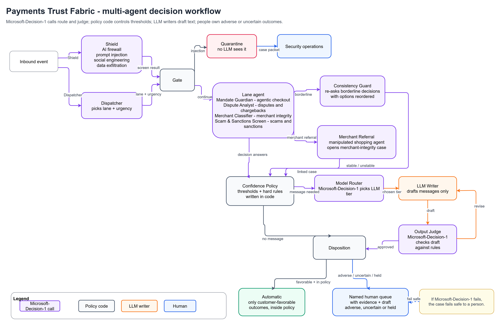
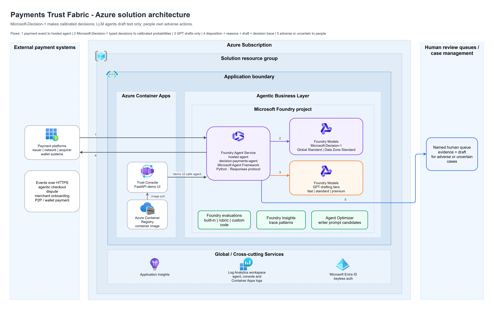

# Architecture

Payments Trust Fabric is one hosted agent in Foundry Agent Service whose code is a Microsoft Agent Framework workflow.
Inside the workflow, Microsoft-Decision-1 makes the decisions and routes the work, LLM agents write the messages, and
policy code decides which outcomes are automatic and which go to people.

> [!IMPORTANT]
> This is a demonstration, not a production system. It runs on synthetic data and isn't connected to any payment
> system. See [From demo to production](../README.md#from-demo-to-production).

- [The pattern](#the-pattern)
- [Microsoft-Decision-1 in this solution](#microsoft-decision-1-in-this-solution)
- [Workflow and routing](#workflow-and-routing)
- [The four lanes](#the-four-lanes)
- [Cross-cutting decision agents](#cross-cutting-decision-agents)
- [Confidence policy and human oversight](#confidence-policy-and-human-oversight)
- [Observability and audit](#observability-and-audit)
- [Azure resources](#azure-resources)
- [Code map](#code-map)
- [Adapt the pattern to another domain](#adapt-the-pattern-to-another-domain)

## The pattern

1. **Screen and route.** Check each request for attacks on the AI (prompt injection, social engineering, data
   exfiltration), quarantine them, and choose the agent that should handle the rest.
2. **Decide.** That agent asks its questions in one Microsoft-Decision-1 call; policy code compares the calibrated answers
   with thresholds that your team owns.
3. **Write and check.** When a message is needed, Microsoft-Decision-1 picks the model tier, an LLM writes the draft, and
   Microsoft-Decision-1 checks the draft against a rubric, sending it back for revision when needed.
4. **Review.** Low-confidence cases and adverse actions go to people, with the decision record attached.

## Microsoft-Decision-1 in this solution

Microsoft-Decision-1 is a decision model: you send a `state` (text or JSON) and typed `questions`, and it returns one
answer per question instead of generated text
([Microsoft Learn](https://learn.microsoft.com/azure/foundry/foundry-models/how-to/use-foundry-models-microsoft-decision)).

| Question type | Used for | Answer |
|---|---|---|
| `noul` | Gates and filters: is this true? | Probability from 0 to 1 |
| `choice` | Classification and routing: which option? | Selected option and a probability for each option |
| `score` | Ordering and thresholds: how much? | Value on an ordered scale and a probability for each level |

How the solution uses it:

- **Several related questions per call.** The Mandate Guardian answers 8 questions about one cart in one call, including
  one question per cart line. The Merchant Classifier answers 11 or more, including one per website sentence.
- **Calibrated probabilities drive policy.** Thresholds live in `trust_fabric/policy.py`, so a risk team can review, test,
  and version them like any other control.
- **Fixed answer sets.** Answers come only from the options in `trust_fabric/questions.py`, and every case-level `choice`
  question includes `cannot_tell`, which routes to a person.
- **Endpoint and authentication.** Calls go to `POST {foundry-resource}/providers/microsoft/v1/systemone` with Microsoft
  Entra ID tokens (`trust_fabric/decision_engine.py`). The client load-balances across one or more deployments
  (`DECISION_MODEL_DEPLOYMENT`, comma-separated), rate-limits itself per deployment, retries transient errors, and
  records every call in a decision ledger.

## Workflow and routing

Microsoft-Decision-1 never calls another agent. It returns typed answers, and the Agent Framework workflow reads them on
switch-case edges to choose the next agent (`trust_fabric/workflow.py`).

| Route | Decided by | Microsoft-Decision-1 answer used |
|---|---|---|
| Quarantine or continue | Shield | `prompt_injection` ≥ 0.70 or `data_exfiltration` ≥ 0.80 |
| Which lane agent | Dispatcher | `lane` choice; confidence below 0.55 goes to human triage |
| Automatic, consumer step-up, or analyst queue | Lane agent and confidence policy | Calibrated probabilities against thresholds |
| Second opinion | Consistency Guard | Re-asks the deciding question with options reversed when its confidence is below 0.70 |
| Liability assessment | Dispute Analyst, then Liability Arbiter | `reason_category` = `agent_purchase_mismatch` |
| Which LLM writes | Model Router | `model_tier` choice: fast, standard, or premium |
| Accept, revise, or hand to a person | Output Judge | Rubric `noul` answers and a quality score |
| Cross-lane hand-off | Mandate Guardian, then Merchant Referral | `manipulation_detected` ≥ 0.70 |

The workflow is built per request by `build_agent()`, so runs never share state, and is served by
`ResponsesHostServer` (Responses protocol) in `main.py`.

## The four lanes

### Agentic checkout

Input: the shopper's intent mandate (text plus a hard spending cap), the AI agent's identity (signature and registry
status), the cart, and the agent's browsing trace (the page text the agent read).

| Agent | Decisions | Notes |
|---|---|---|
| Mandate Guardian | `mandate_match`, `substitution_acceptable`, `out_of_scope_items`, `manipulation_detected`, `agent_risk` (score), `action` (choice), and `line_N_in_mandate` for every cart line | Deterministic checks run alongside: hard spending cap, merchant categories blocked for agents, unverified agent signatures |
| Consumer Confirmation Agent (LLM) | — | One-screen confirmation request or "paused for review" notice |
| Output Judge | States amount and merchant, explains the deviation, no pressure or dark patterns, clarity | Up to two revisions |
| Merchant Referral | Runs the merchant classifier on the page that manipulated the agent | Opens a linked merchant-integrity case |

Outcomes: `AUTO_APPROVE`, `CONSUMER_STEP_UP`, `RISK_REVIEW`.

### Disputes and chargebacks

| Agent | Decisions |
|---|---|
| Dispute Analyst | `reason_category` (card-absent fraud, not received, not as described, cancelled recurring, duplicate processing, credit not processed, incorrect amount, agent purchase mismatch, cannot tell), `billing_error_notice`, `first_party_misuse_signals`, `household_or_known_user`, `urgency`, `evidence_contradicts_claim`, `evidence_strength`, `recommended_outcome` |
| Agent Liability Arbiter | `agent_exceeded_mandate`, `merchant_steered_agent`, `consumer_confirmed_purchase`, `liable_party` (only for agent-purchase disputes) |
| Dispute Case Writer (LLM) and Output Judge | Customer letter and analyst summary; the judge checks for premature promises and blame |

Outcomes: `AUTO_CREDIT` (small, clear errors in the cardholder's favor), `AUTO_REQUEST_INFO`, `ANALYST_REVIEW`. Denials
are never automatic.

### Merchant integrity

| Agent | Decisions |
|---|---|
| Merchant Classifier | `observed_mcc_family`, `declared_mcc_mismatch`, `prohibited_goods`, `integrity_risk_category`, `deceptive_billing`, `agent_manipulation`, `dispute_risk` (score), `action`, and `sentence_N_risk_evidence` for each website sentence |
| Underwriting Memo Agent (LLM) and Output Judge | Memo that cites the flagged sentences; the judge rejects speculative claims |

Outcomes: `AUTO_APPROVE` (no LLM call), `APPROVE_WITH_MONITORING`, `UNDERWRITER_REVIEW`, `COMPLIANCE_REFERRAL`.

### Scams, sanctions, and account protection

| Agent | Decisions |
|---|---|
| Scam and Sanctions Screen | `sanctions_true_hit` (a real sanctioned party or jurisdiction versus a benign mention), `scam_typology`, `coached_customer`, `vulnerability_indicators`, `ato_signals`, `scam_risk` (score), `intervention` |
| Customer Protection Agent (LLM) and Output Judge | Specific warning plus a callback script; the judge blocks any request for secrets |

Outcomes: `ALLOW`, `AUTO_WARNING` (the customer still decides), `HUMAN_HOLD` (callback), `ACCOUNT_SECURITY_REVIEW`,
`SANCTIONS_HOLD` (no automatic customer message).

## Cross-cutting decision agents

| Agent | What it decides |
|---|---|
| Shield | Is the event an attack on the AI? Quarantine it before any LLM sees it. |
| Dispatcher | Which lane, how urgent |
| Model Router | The least expensive LLM tier that can write the draft well |
| Output Judge | Accept, revise (up to twice), or hand to a person for editing |
| Consistency Guard | Is a borderline automatic decision stable when the options are reordered? |
| Agent Liability Arbiter | Who bears the loss in an agent-purchase dispute |
| Merchant Referral | Should a manipulative merchant get its own integrity case? |

## Confidence policy and human oversight

- **Automatic outcomes only go in the customer's favor.** Everything adverse goes to a person: the consumer (step-up) or
  a named queue (risk desk, disputes analyst, underwriting, compliance, sanctions, scam intervention, security operations).
- **Thresholds are explicit code** in `trust_fabric/policy.py`, for example auto-credit requires the deciding answer at
  0.60 or higher, an amount at or below the auto-credit limit, misuse below 0.30, and contradicting evidence below 0.40.
- **Hard limits are deterministic:** spending caps, blocked merchant categories for agents, unverified agent signatures,
  sanctions holds, and no automatic denials.
- **Abstention:** `cannot_tell` routes to a person.
- **Second opinion:** the Consistency Guard escalates a borderline automatic decision if reversing the options changes it.
- **LLMs never see untrusted content first:** the Shield screens it, and quarantined events never reach an LLM.
- **Fail safe:** if Microsoft-Decision-1 can't be reached, the case goes to human triage rather than guessing.

## Observability and audit

- **Case record:** every decision with its question, options, probabilities, latency, tokens, and cost, plus the
  disposition, reasons, queue, and any draft (`trust_fabric/case.py`, `trust_fabric/report.py`).
- **Tool calls in the response:** `trust_fabric/tooltrace.py` returns each Microsoft-Decision-1 call (`microsoft_decision_1`)
  and policy step (`apply_trust_policy`) as a function call and output pair, so evaluators and Foundry Insights see the
  evidence behind each outcome.
- **Traces:** Agent Framework instrumentation plus one OpenTelemetry span per Microsoft-Decision-1 call, sent to the
  Application Insights resource connected to the Foundry project.
- **Prompt lineage:** each draft records the writer prompt set that produced it (`prompt_config`, `baseline@<hash>`).

## Azure resources

The diagram shows the production shape: issuer, network, acquirer, and wallet systems send events to the hosted agent
(flow 1) and receive the outcome, reasons, draft, and decision trace (flow 4), and adverse or uncertain cases go to
people (flow 5). In this demo, a synthetic dataset and the web console stand in for the payment systems and the case
management system. Customer, merchant, AI agent registry, watch list, and policy lookups come from `data/reference.json`
(`trust_fabric/case.py`); in production they would come from your systems of record.

| Resource (names use a unique suffix) | Details |
|---|---|
| Resource group `rg-<environment-name>` | Created by `azd provision` |
| Foundry resource `aif-<suffix>` and project `proj-<suffix>` | `AIServices` kind, system-assigned identity, project management enabled, local authentication disabled |
| Model deployments | `decision-model` (and optionally `decision-model-2`), `gpt-5.4-mini`, `gpt-5.6-luna`, `gpt-6-sol`; deployment types and capacities are parameters |
| Hosted agent `decision-payments-agent` | Code deploy with remote build, Python 3.13, 1 vCPU and 2 GiB, Responses protocol; its own Microsoft Entra agent identity |
| Application Insights `appi-<suffix>` and Log Analytics `log-<suffix>` | Connected to the Foundry project for tracing; console logs |
| Container Apps environment `cae-<suffix>` and app `ca-console-<suffix>` | Console, one replica (the review queue and rate limiter live in memory) |
| Container registry `cr<suffix>` | Console image, built remotely by azd |
| Managed identity `id-console-<suffix>` | Console identity: AcrPull on the registry, Foundry User on the Foundry resource |

Role assignments:

| Principal | Role | Scope | Created by |
|---|---|---|---|
| Console identity | Foundry User | Foundry resource | Bicep |
| Console identity | AcrPull | Container registry | Bicep |
| You (the deploying user) | Cognitive Services User | Foundry resource | Bicep |
| Hosted agent identity | Foundry User | Foundry resource | `scripts/grant_agent_access.py` after each deploy |

## Code map

| Path | Contents |
|---|---|
| `src/payments-trust-fabric/trust_fabric/questions.py` | Decision catalog: every Microsoft-Decision-1 question, option, and criterion |
| `src/payments-trust-fabric/trust_fabric/policy.py` | Confidence policy and deterministic rules |
| `src/payments-trust-fabric/trust_fabric/stages.py` | Decision stages shared by the agent, the console, and the evaluation tools |
| `src/payments-trust-fabric/trust_fabric/executors_core.py`, `executors_lanes.py`, `workflow.py` | Agent Framework executors and graph |
| `src/payments-trust-fabric/trust_fabric/decision_engine.py` | Microsoft-Decision-1 client: load balancing, rate limiting, retries, ledger, spans |
| `src/payments-trust-fabric/trust_fabric/llm.py`, `prompts.py` | LLM writers and their prompts (loaded from `.agent_configs/baseline/`) |
| `src/payments-trust-fabric/trust_fabric/tooltrace.py` | Decisions and policy steps returned as tool calls |
| `console/app.py`, `console/static/` | Console API and UI |
| `tools/datagen/`, `tools/generate_data.py` | Synthetic data generator (120 labeled events, 11 demo scenarios) |

## Adapt the pattern to another domain

1. **Write the questions.** Add a lane to `questions.py` with `noul`, `choice`, and `score` questions and clear criteria
   for each option, including `cannot_tell`.
2. **Write the policy.** Add a function to `policy.py` that maps the answers to outcomes, with automatic outcomes only
   where an error is cheap and reversible.
3. **Add the stage and executor.** Add a stage in `stages.py` and an executor in `executors_lanes.py`, then connect it in
   `workflow.py` with a `Case` on the gate's switch-case edge group.
4. **Label and calibrate.** Collect a few hundred labeled historical cases, measure accuracy and calibration, and set
   thresholds with the people who own the risk.
