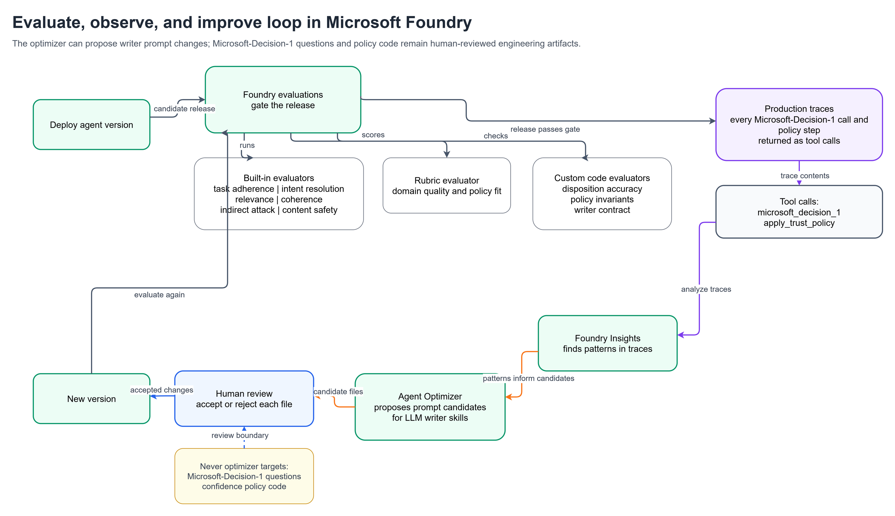

# Evaluation and improvement

The repository includes tools to measure the decision path, compare Microsoft-Decision-1 with LLMs, and evaluate and
improve the deployed hosted agent with Microsoft Foundry. Install the tool dependencies first:

```bash
pip install -r tools/requirements.txt
```

The tools read endpoints and deployment names from the active azd environment (`.azure/<env>/.env`), so run them from
the repository root after `azd up`. Data generation needs only the Python standard library.



## Synthetic data

| Tool | What it does |
|---|---|
| `python tools/generate_data.py` | Builds 120 labeled events (agentic checkout, disputes, merchant reviews, peer-to-peer payments, general questions, prompt-injection attacks) and reference data from `tools/datagen/`, and writes them to `src/payments-trust-fabric/data/` and `console/data/` |
| `python tools/build_golden.py` | Builds `evals/golden.jsonl` (expected behavior per event) |
| `python tools/foundry/build_eval_sets.py` | Builds `evals/foundry_golden.jsonl` (120 label-free queries for agent-target evaluation) and `evals/optimizer_tasks.jsonl` (18 tasks for the Agent Optimizer) |

All names in the data are fictitious. Rerun the three commands after you edit `tools/datagen/`, then deploy both services.

## Decision path and benchmark

| Tool | What it does |
|---|---|
| `python tools/evaluate.py [--only DP-]` | Runs the full Microsoft-Decision-1 path (no LLM drafting) on the labeled events and reports disposition accuracy, per-question accuracy, latency, tokens, and cost. Writes `console/data/firehose_baseline.json` for the console's Firehose baseline. |
| `python tools/benchmark.py [--models gpt-5.4-mini,gpt-6-sol]` | Asks Microsoft-Decision-1 and LLMs the same labeled decisions with identical instructions and options. Reports accuracy, median and 95th percentile latency, cost per 1,000 decisions, and answer changes when options are reordered. Writes `console/data/benchmark.json` for the console's Benchmark tab. Set the LLM prices in `LLM_PRICES` to your current Azure prices. |
| `python tools/e2e_cloud.py [--heroes 3 --firehose 0 --skip-calibrate]` | Smoke or end-to-end test of the deployed console and hosted agent |

To show the baseline and benchmark in the console, run the two tools and then `azd deploy console`.

Read the benchmark with care: content filters on LLM deployments can block adversarial test items (counted as "no
decision"), latency includes network time from where you run the tool, and a small labeled set in one domain isn't a
general model ranking.

## Foundry evaluations of the hosted agent

| Tool | What it does |
|---|---|
| `python tools/foundry/register_evaluators.py` | Registers the dataset (`ptf-golden`), two deterministic code evaluators (`ptf_disposition_accuracy`, `ptf_policy_invariants`), and the `ptf_case_quality` rubric evaluator (LLM judge, generated by Foundry from `evals/rubric_context.md`, or the reviewed rubric in `evals/rubric_dimensions.json`) |
| `python tools/foundry/run_batch_eval.py [--limit 3]` | Agent-target batch evaluation of the deployed agent with built-in quality evaluators (task adherence, intent resolution, relevance, coherence), built-in safety evaluators (indirect attack, violence, hate and unfairness), the rubric, and the code evaluators |
| `python tools/foundry/analyze_eval.py <run.json>` | Pass rates, per-lane results, and the failing items with the judges' reasons |
| `python tools/foundry/compare_evals.py <baseline.json> <candidate.json>` | Compares two runs and lists verdicts that changed |
| `python tools/foundry/rubric_compare.py <run.json>` | Scores saved responses with two rubrics and reports agreement |

The writer contract (`tools/foundry/evaluators/writer_contract.py`) checks the shape and length limits of every draft.

Tips:

- **Return the evidence.** The agent returns each Microsoft-Decision-1 call and policy step as a tool call
  (`trust_fabric/tooltrace.py`), so LLM judges can see why an outcome was chosen.
- **Pair generic evaluators with domain checks.** A correct safety pause, such as a quarantined prompt-injection attempt,
  can look like an unmet intent to a generic judge. The deterministic code evaluators check what matters for this domain.
- **Expect run-to-run noise.** LLM judges change a few percent of verdicts between identical runs; compare runs at the
  scale of the whole suite.

## Insights and traffic

| Tool | What it does |
|---|---|
| `python tools/foundry/drive_traffic.py [--limit N]` | Sends the golden events to the deployed agent and saves every response, which produces production-style traces |
| `python tools/foundry/score_traffic.py` | Scores saved responses with the deterministic code evaluators |
| `python tools/foundry/insights.py scan --lookback-hours 6` | Creates or reuses the agent's Insights monitor, analyzes recent traces, and lists the findings with evidence |

Validate each Insight against the labels and the case record before you act on it.

## Agent Optimizer

The writer prompts in `src/payments-trust-fabric/.agent_configs/baseline/` (a shared communications policy plus one
skill per writer role) are ready for the
[Agent Optimizer](https://learn.microsoft.com/azure/foundry/agents/concepts/agent-optimizer-overview). The questions,
thresholds, and policy code aren't optimizer targets: they're deterministic and tested.

```bash
# Set agent.version in eval.yaml to the deployed version (azd env value AGENT_DECISION_PAYMENTS_AGENT_VERSION)
azd ai agent optimize --config eval.yaml
python tools/foundry/optimizer_status.py <job-id> --watch
azd ai agent optimize apply --candidate <candidate-id>
```

Review each changed file before you accept it. Reject any change that lets a writer choose outcomes, because
Microsoft-Decision-1 decides and LLMs only write. Copy the accepted files into `baseline/`, add a line to
`baseline/CHANGELOG.md`, remove any `OPTIMIZATION_*` variables that `optimize apply` added to `azure.yaml`, deploy, and
re-evaluate the whole suite before you keep the change.
